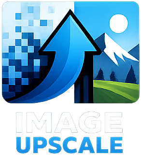

<div align="center">
  
  <h1>🚀 x2 UpScale</h1>
  <p>
    <a href="README.md">🏠 Home</a> •
    <a href="README.ru.md">🇷🇺</a> •
    <a href="README.ua.md">🇺🇦</a>
  </p>
  <br>
</div>

# 🇬🇧 x2 UpScale — English

**x2 UpScale** — AI-powered image upscaling tool with GUI and CLI.

Powered by **Real-ESRGAN ncnn (Vulkan)** — works on any GPU, no CUDA required.  
Optional **Real-ESRGAN x4plus (CUDA)** for photorealism.

---

## ✨ Features

| Feature | Description |
|---------|-------------|
| 🎨 **Animation / Claymation** | ncnn Vulkan — built-in, works out of the box |
| 📷 **Photorealism** | PyTorch CUDA — optional |
| 🖥️ **Graphical Interface** | PyQt6, dark Fusion theme |
| ⌨️ **CLI** | Full command-line mode |
| 🌍 **Multilingual** | 🇷🇺 🇺🇦 🇬🇧 — switch via flags |
| 🔄 **Batch Processing** | Process entire folders |
| 🧩 **Tiling** | Large image support via tiles |
| 🎚️ **Scale 1×–4×** | Smooth slider + presets |

---

## 🚀 Quick Start

```bash
# 1️⃣ Install Python 3.10+ (https://python.org/downloads)
# 2️⃣ Install dependencies
pip install -r requirements.txt

# 3️⃣ Launch GUI
python main.py

# Or CLI:
python main.py photo.jpg --out result.png
```

### 📦 Photo mode (optional)

```bash
pip install -r requirements-photo.txt
```
The `RealESRGAN_x4plus.pth` (67 MB) model will auto-download on first use.

---

## 🖥️ Interface

### GUI

```bash
python main.py
```

### CLI

```bash
python main.py image.jpg -o result.png
python main.py input_folder/ --out output_folder/
python main.py --list-methods
```

---

## 🧠 Backends

| Model | Engine | Type | Requirements |
|-------|--------|------|-------------|
| 🔮 **AnimeVideoV3** | ncnn Vulkan | Animation / Claymation | Any Vulkan GPU (built-in) |
| 📷 **RealESRGAN x4plus** | PyTorch CUDA | Photorealism | NVIDIA + `requirements-photo.txt` |

---

## 🏗️ Project Structure

```
x2-upscale/
├── main.py                    # Entry point
├── install.bat                # Windows installer
├── requirements.txt           # Base dependencies (Pillow, PyQt6)
├── requirements-photo.txt     # Photo mode (torch, realesrgan)
├── bin/ncnn/                  # Real-ESRGAN ncnn Vulkan (built-in)
│   ├── realesrgan-ncnn-vulkan.exe
│   ├── vcomp140.dll
│   └── models/realesr-animevideov3-x2.*
├── app/
│   ├── gui/app.py             # PyQt6 GUI
│   ├── models/                # Upscale backends
│   ├── core.py                # Orchestrator
│   └── logo.png               # Logo
└── models/realesrgan/         # x4plus.pth downloads here
```

---

## 📋 System Requirements

- **Python 3.10+**
- **GPU with Vulkan** — for ncnn (NVIDIA, AMD, Intel — any)
- **NVIDIA GPU + CUDA** — for photo mode (optional)

---

## 🏆 Credits

This project uses the following Open Source components:

| Project | Author | Description |
|---------|--------|-------------|
| [Real-ESRGAN](https://github.com/xinntao/Real-ESRGAN) | [Xintao Wang](https://github.com/xinntao) | Core AI upscaling algorithm |
| [ncnn Real-ESRGAN](https://github.com/xinntao/Real-ESRGAN-ncnn-vulkan) | [Xintao Wang](https://github.com/xinntao) | Vulkan binary (ncnn) |
| [PyTorch](https://pytorch.org) | Meta | Framework for photo mode |
| [PyQt6](https://www.riverbankcomputing.com/software/pyqt/) | Riverbank Computing | GUI framework |
| [Pillow](https://python-pillow.org) | — | Image processing |

**Made with ❤️ by [Mr3ster](https://github.com/ZetHor3)**

---

<br>

<div align="center">
  <sub>© 2026 <a href="https://github.com/ZetHor3">Mr3ster</a> | Powered by <a href="https://github.com/xinntao/Real-ESRGAN">Real-ESRGAN</a></sub>
  <br>
  <sub><a href="https://boosty.to/mr3ster/donate">💜 Support Us</a></sub>
</div>
