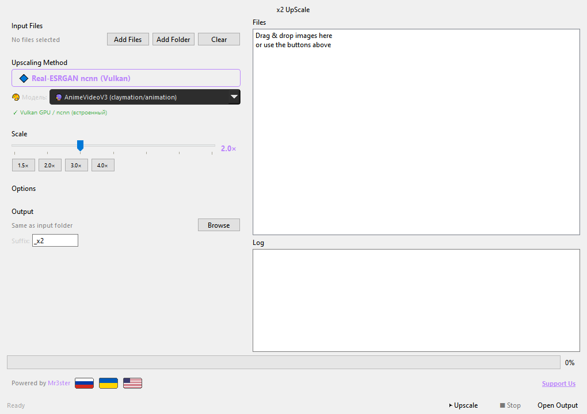

<div align="center">
  
  <h1>🚀 x2 UpScale</h1>
  <p>
    <a href="README.md">🏠 English</a> •
    <a href="README.ru.md">🇷🇺</a>
  </p>
  <br>
  <p>
    
    
    
    
  </p>
  <br>
</div>

# 🇺🇦 x2 UpScale — Українська

**x2 UpScale** — програма для збільшення зображень у 2×–4× за допомогою ШІ.

Працює на **Real-ESRGAN ncnn (Vulkan)** — не потребує CUDA/PyTorch, підходить для будь-якого GPU.  
Фотореалістичний режим через **Real-ESRGAN x4plus (CUDA)** — опціонально.

---

## ✨ Можливості

| Можливість | Опис |
|-------------|---------|
| 🎨 **Анімація / Claymation** | ncnn Vulkan — вбудовано, працює одразу на будь-якому GPU |
| 📷 **Фотореалізм** | PyTorch CUDA — опціонально |
| 🖥️ **Графічний інтерфейс** | PyQt6, темна тема Fusion |
| ⌨️ **CLI** | Повноцінний консольний режим |
| 🌍 **Багатомовність** | 🇷🇺 🇺🇦 🇬🇧 — перемикання прапорцями |
| 🔄 **Batch обробка** | Ціла папка |
| 🧩 **Tiling** | Обробка великих зображень по тайлах |
| 🎚️ **Scale 1×–4×** | Плавний слайдер + пресети |

---

## 🚀 Швидкий старт

```bash
# 1️⃣ Встановити Python 3.10+ (https://python.org/downloads)
# 2️⃣ Встановити залежності
pip install -r requirements.txt

# 3️⃣ Запустити GUI
python main.py

# Або CLI:
python main.py photo.jpg --out result.png
```

### 📦 Для фоторежиму (опціонально)

```bash
pip install -r requirements-photo.txt
```
Модель `RealESRGAN_x4plus.pth` (67 МБ) завантажиться автоматично при першому перемиканні на фоторежим.

---

## 🖥️ Інтерфейс

### GUI



```bash
python main.py
```

### CLI

```bash
python main.py image.jpg -o result.png
python main.py input_folder/ --out output_folder/
python main.py --list-methods
```

---

## 🧠 Backends (моделі)

| Модель | Движок | Тип | Вимоги |
|--------|--------|-----|--------|
| 🔮 **AnimeVideoV3** | ncnn Vulkan | Анімація / Claymation | Будь-який GPU з Vulkan (вбудовано) |
| 📷 **RealESRGAN x4plus** | PyTorch CUDA | Фотореалізм | NVIDIA + `requirements-photo.txt` |

---

## 🏗️ Структура проекту

```
x2-upscale/
├── main.py                    # Точка входу
├── install.bat                # Інсталятор для Windows
├── requirements.txt           # Базові залежності (Pillow, PyQt6)
├── requirements-photo.txt     # Для фоторежиму (torch, realesrgan)
├── bin/ncnn/                  # Real-ESRGAN ncnn Vulkan (вбудовано)
│   ├── realesrgan-ncnn-vulkan.exe
│   ├── vcomp140.dll
│   └── models/realesr-animevideov3-x2.*
├── app/
│   ├── gui/app.py             # PyQt6 GUI
│   ├── models/                # Бекенди upscale
│   ├── core.py                # Оркестратор
│   └── logo.png               # Логотип
└── models/realesrgan/         # Сюди завантажується x4plus.pth
```

---

## 📋 Системні вимоги

- **Python 3.10+**
- **GPU з Vulkan** — для ncnn (NVIDIA, AMD, Intel — будь-який)
- **NVIDIA GPU + CUDA** — для фоторежиму (опціонально)

---

## 🏆 Подяки (Credits)

| Проєкт | Автор |
|--------|-------|
| [Real-ESRGAN](https://github.com/xinntao/Real-ESRGAN) | [Xintao Wang](https://github.com/xinntao) |
| [ncnn Real-ESRGAN](https://github.com/xinntao/Real-ESRGAN-ncnn-vulkan) | [Xintao Wang](https://github.com/xinntao) |
| [PyTorch](https://pytorch.org) | Meta |
| [PyQt6](https://www.riverbankcomputing.com/software/pyqt/) | Riverbank Computing |
| [Pillow](https://python-pillow.org) | — |

**Зроблено з ❤️ [Mr3ster](https://github.com/ZetHor3)**

---

<br>

<div align="center">
  <sub>© 2026 <a href="https://github.com/ZetHor3">Mr3ster</a> | Powered by <a href="https://github.com/xinntao/Real-ESRGAN">Real-ESRGAN</a></sub>
  <br>
  <sub><a href="https://boosty.to/mr3ster/donate">💜 Підтримати</a></sub>
</div>
